# Verified Profile

**Your work. Your identity. One profile.**

Verified Profile explores a clearer way to present a professional identity, projects, and credentials together. The current release is a **public, read-only dashboard showcase** with a clean blue-and-white design that adapts to desktop, tablet, and mobile screens.

**[Explore the live showcase](https://verified-profile-demo.black-tooth-5474.workers.dev/demo/) · [Read the user manual](manual.md) · [Browse all documentation](docs/README.md)**

> **Release status:** the Cloudflare showcase is live. It is not a signed-in account or a working verification service. Navigation works; sign-in, editing, saving, publishing, and account actions are intentionally unavailable. The sample records do not prove anyone's identity or work history.

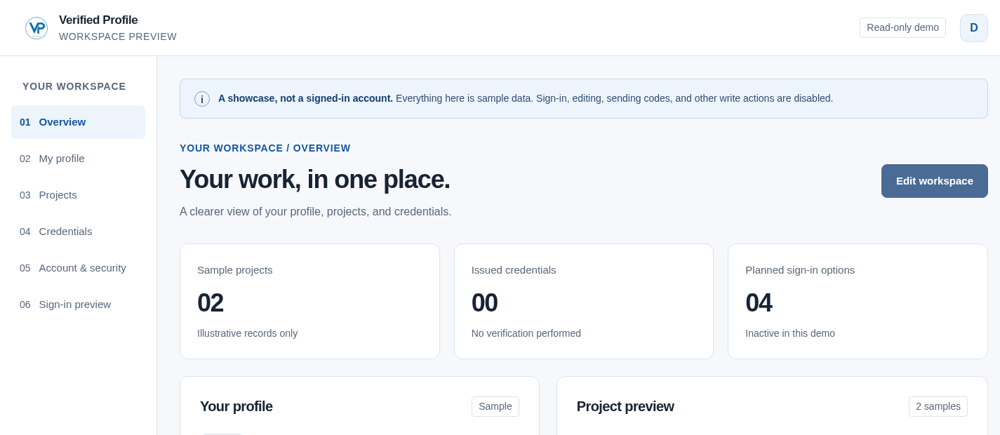
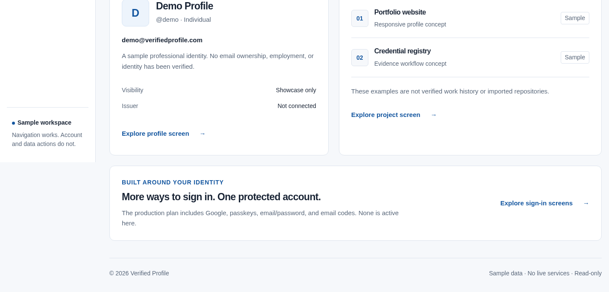

## Contents

- [What Verified Profile is for](#what-verified-profile-is-for)
- [Start exploring](#start-exploring)
- [The six dashboard tabs](#the-six-dashboard-tabs)
- [Screenshot gallery](#screenshot-gallery)
- [What works today](#what-works-today)
- [Planned account features](#planned-account-features)
- [Privacy and trust](#privacy-and-trust)
- [Documentation map](#documentation-map)
- [Project structure](#project-structure)
- [For contributors](#for-contributors)
- [Review and release flow](#review-and-release-flow)
- [Quality, limitations, and notices](#quality-limitations-and-notices)

## What Verified Profile is for

The product direction is simple: bring the important parts of someone's professional story into one understandable place.

- **A clearer identity:** a name, handle, short introduction, and visibility choices.
- **Work with context:** projects accompanied by descriptions and source information.
- **Credentials with meaning:** who issued a credential, what it says, and whether there is evidence behind it.
- **Account control:** understandable sign-in and account-management choices.

These are product goals, not a claim that every service is ready. The live showcase demonstrates the screens and language; real accounts and verification remain future work.

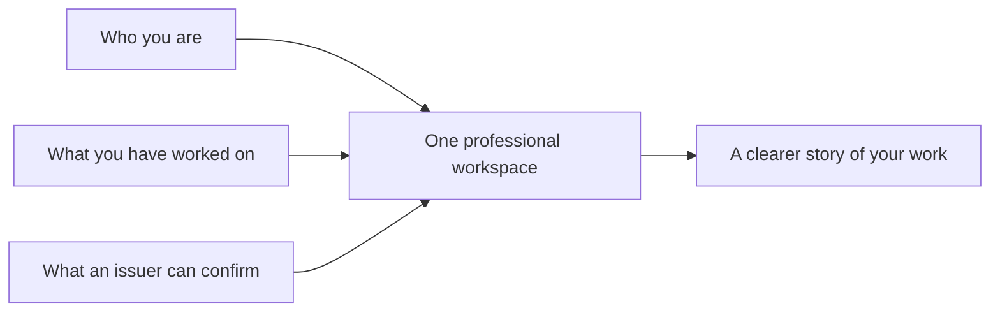

_Product illustration only. Issuers and real records are not connected in this release._

## Start exploring

1. Open the [live showcase](https://verified-profile-demo.black-tooth-5474.workers.dev/demo/).
2. Choose a tab in the left-hand menu. On a phone, first select **Menu** at the top.
3. Read the sample information and the status labels on each screen.
4. Use the [user manual](manual.md) for a guided explanation of every section and button.

You do **not** need an account, password, email code, or payment to view the showcase. There is no demo login to complete. Do not enter or reuse real credentials.

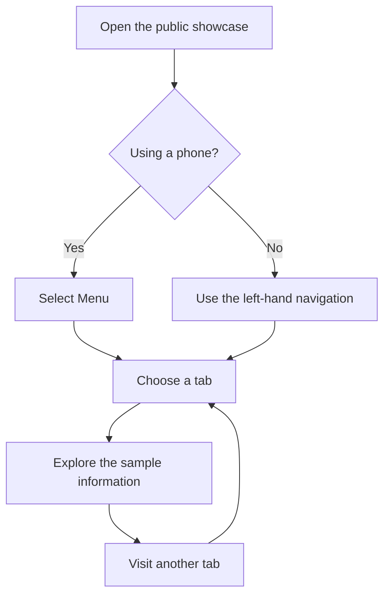

## The six dashboard tabs

| Tab                                                                                                | What it helps explain                                                                          | What you can do now                                                           |
| -------------------------------------------------------------------------------------------------- | ---------------------------------------------------------------------------------------------- | ----------------------------------------------------------------------------- |
| **[Overview](https://verified-profile-demo.black-tooth-5474.workers.dev/demo/#overview)**          | A quick picture of the sample workspace: profile, project previews, and status totals.         | Read the cards and follow links to other screens.                             |
| **[My profile](https://verified-profile-demo.black-tooth-5474.workers.dev/demo/#profile)**         | How a name, handle, email, introduction, badge, and visibility settings could appear together. | View sample details. Saving and publishing are unavailable.                   |
| **[Projects](https://verified-profile-demo.black-tooth-5474.workers.dev/demo/#projects)**          | How projects could be described with source information and a clear verification status.       | Read two fictional project examples. Adding and editing are unavailable.      |
| **[Credentials](https://verified-profile-demo.black-tooth-5474.workers.dev/demo/#badges)**         | The difference between a profile and a credential issued by a named organization.              | Read the honest empty state: no credentials have been issued.                 |
| **[Account & security](https://verified-profile-demo.black-tooth-5474.workers.dev/demo/#account)** | Planned sign-in methods, sessions, data export, and account deletion controls.                 | Review the layout. None of the account controls operate.                      |
| **[Sign-in preview](https://verified-profile-demo.black-tooth-5474.workers.dev/demo/#signin)**     | Four proposed ways to access a future account.                                                 | Compare the explanations. No sign-in, email sending, or device prompt occurs. |

The **Credentials** address ends in `#badges`; the visible tab is correctly named **Credentials**. A **passkey** means a sign-in credential used through a supported device, often unlocked with a fingerprint, face scan, or device PIN. It is shown here as a planned option only.

## Screenshot gallery

These are screenshots of the **actual live Cloudflare showcase**, not drawings or future-production mockups. Captured on **29 October 2026, Malaysia time** (28 October UTC), at 1440px desktop and 390px mobile widths. The gallery uses preview portions where a capture needs two image parts; the manual includes every continuation. Select an image to open it at full size.

| Overview                                                                                                                                          | My profile                                                                                                                                                              |
| ------------------------------------------------------------------------------------------------------------------------------------------------- | ----------------------------------------------------------------------------------------------------------------------------------------------------------------------- |
| [](docs/screenshots/overview-1440.svg)                        | [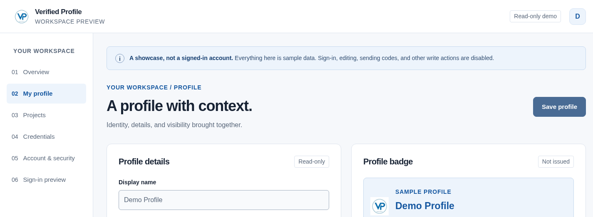](docs/screenshots/profile-1440.svg)          |
| **Projects**                                                                                                                                      | **Credentials**                                                                                                                                                         |
| [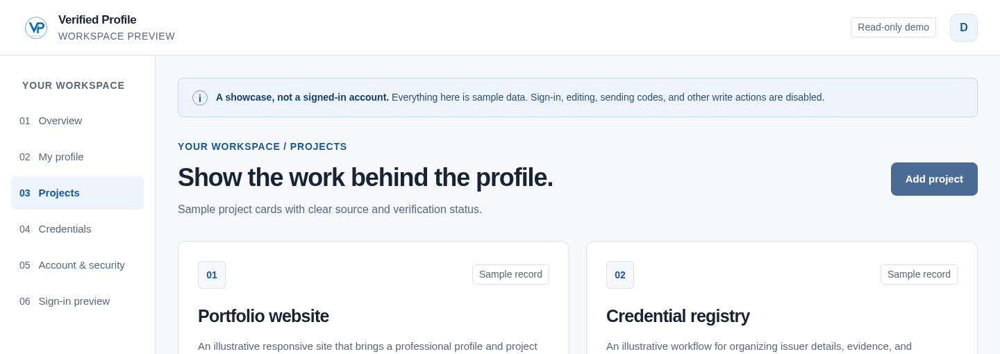](docs/screenshots/projects-1440.svg) | [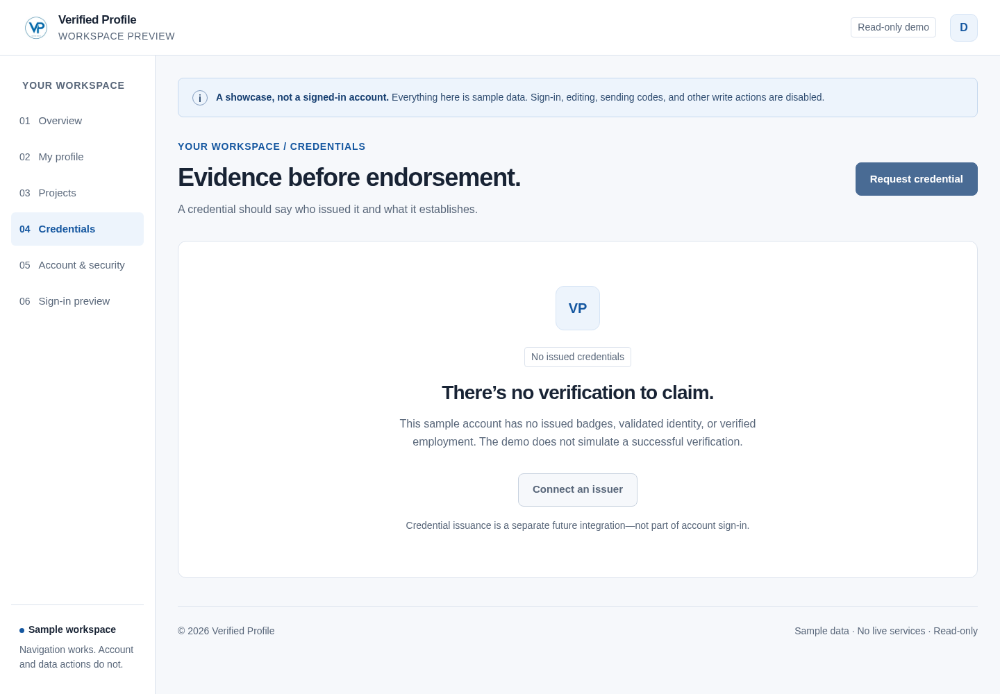](docs/screenshots/credentials-1440.svg)           |
| **Account & security**                                                                                                                            | **Sign-in preview**                                                                                                                                                     |
| [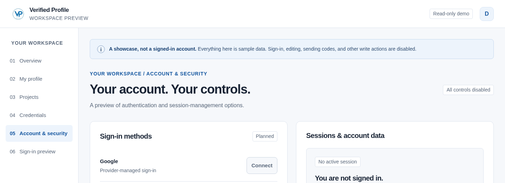](docs/screenshots/account-security-1440.svg)   | [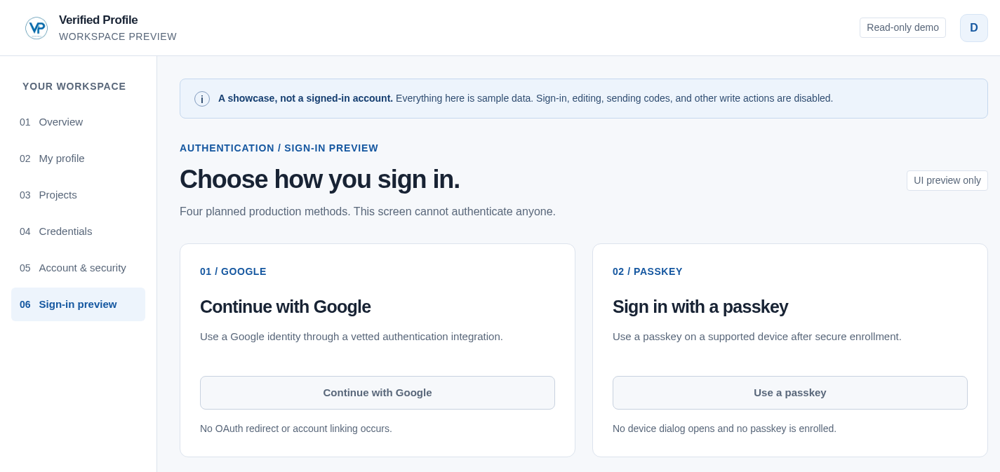](docs/screenshots/sign-in-preview-1440.svg) |

**Mobile:** [Overview](docs/screenshots/overview-390.svg) · [My profile](docs/screenshots/profile-390.svg) · [Projects](docs/screenshots/projects-390.svg) · [Credentials](docs/screenshots/credentials-390.svg) · [Account & security](docs/screenshots/account-security-390.svg) · [Sign-in preview](docs/screenshots/sign-in-preview-390.svg) · [Expanded menu](docs/screenshots/mobile-menu-390.svg)

See the [screen-by-screen manual](manual.md#screen-by-screen-guide) for larger images, mobile previews, and feature explanations. Capture details and integrity checks are recorded in [the screenshot manifest](docs/screenshots/manifest.json).

## What works today

| Feature                            | Current behavior                                                                                                 |
| ---------------------------------- | ---------------------------------------------------------------------------------------------------------------- |
| Six-screen navigation              | Working. The selected menu item identifies the current screen.                                                   |
| Mobile menu                        | Working. Open Menu, choose a screen, or use Escape to close it when using a keyboard.                            |
| Direct screen links                | Working. Each link above opens the intended tab. An unrecognized tab falls back to Overview.                     |
| Responsive layout                  | Working. Cards reorganize for smaller screens and the navigation changes to a mobile menu.                       |
| Keyboard support                   | Implemented: skip link, visible focus, menu controls, and focus movement when changing screens.                  |
| Sample profile and project content | Available to read; clearly labeled as illustrative.                                                              |
| No-issued-credentials state        | Available to read; it does not simulate successful verification.                                                 |
| Read-only protection               | Editing and account controls are disabled. This release does not send authentication or account-change requests. |

The repository also preserves the earlier **landing-page prototype** at its root. That separate prototype includes an in-page profile preview, a sample QR code, and a privacy dialog. It is **not** the dashboard currently deployed to Cloudflare. See the [prototype section of the manual](manual.md#the-separate-landing-page-prototype).

## Planned account features

The following are **not available in the live showcase**:

- Real Google sign-in, passkeys, email/password sign-in, and emailed sign-in codes.
- Saved profiles and projects belonging to an authenticated account.
- Password recovery, session management, account export, or account deletion.
- Publishing a public profile, reserving a handle, or changing visibility.
- Identity or employment checks, issuer connections, and credential issuance.
- Repository imports, GitHub connections, and AI project analysis.

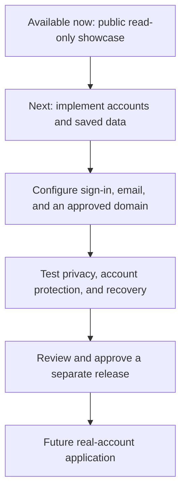

_This diagram is a release plan, not an activation switch. Deploying a screen does not make its account features work._

## Privacy and trust

- Everything displayed in the dashboard is sample information. `demo@verifiedprofile.com` is an illustrative address, not a verified or accessible demo account.
- No profile, password, code, passkey, or account is created by viewing the showcase.
- The dashboard does not save personal entries or send verification emails. Its fields are disabled.
- The application does not add analytics, browser storage, or an account-session cookie. Cloudflare may maintain its own hosting or security logs.
- A logo, profile badge, QR code, or sign-in screen is not evidence that someone's identity, employment, or project ownership has been verified.
- The showcase is public. Its no-index setting discourages search indexing; it does not make the page private.

See [Privacy and safety in the manual](manual.md#privacy-and-safety) and the [authentication requirements](docs/AUTHENTICATION.md).

## Documentation map

| Document                                               | Intended reader                     | What it covers                                                                                                                                                     |
| ------------------------------------------------------ | ----------------------------------- | ------------------------------------------------------------------------------------------------------------------------------------------------------------------ |
| **[User manual](manual.md)**                           | Visitors, stakeholders, reviewers   | Plain-language tour of every tab, screen features, screenshots, mobile navigation, privacy, and troubleshooting.                                                   |
| **[Documentation index](docs/README.md)**              | Everyone                            | Where to find product, engineering, evidence, and release documents.                                                                                               |
| [Demo guide](docs/DEMO.md)                             | Maintainers and reviewers           | Static-demo boundaries and implementation behavior.                                                                                                                |
| [Architecture](docs/ARCHITECTURE.md)                   | Implementers                        | Current design and proposed future account architecture, clearly distinguished.                                                                                    |
| [Authentication requirements](docs/AUTHENTICATION.md)  | Implementers and security reviewers | Requirements and acceptance gates for the four requested sign-in methods.                                                                                          |
| [GitHub Flow and release runbook](docs/GITHUB_FLOW.md) | Maintainers                         | Review process, Pages workflow, release gates, and rollback.                                                                                                       |
| [Cloudflare deployment runbook](docs/CLOUDFLARE.md)    | Maintainers                         | Live deployment record, static Worker packaging, verification, redeployment, and withdrawal. Merged in [PR #2](https://github.com/DevJel/verified-profile/pull/2). |
| [Screenshot evidence](docs/screenshots/README.md)      | Reviewers                           | Live capture method, dates, image list, and integrity records.                                                                                                     |
| [Change history](CHANGELOG.md)                         | Everyone                            | User-visible changes and their release status.                                                                                                                     |
| [Third-party notices](THIRD_PARTY_NOTICES.md)          | Maintainers and redistributors      | Notices for included third-party material.                                                                                                                         |

## Project structure

```text
verified-profile/
├── README.md                     Start here: purpose, status, features, and links
├── manual.md                     Detailed, non-technical user guide
├── CHANGELOG.md                  User-visible change history
├── index.html                    Separate original landing-page prototype
├── styles.css / app.js           Original prototype appearance and behavior
├── assets/                       Original prototype logo
├── vendor/                       Included QR-code library and its notices
├── demo/
│   ├── index.html                Six-screen read-only dashboard
│   ├── styles.css                Responsive dashboard appearance
│   ├── demo.js                   Screen and menu navigation only
│   └── assets/                   Dashboard logo
├── docs/
│   ├── README.md                 Documentation index
│   ├── ARCHITECTURE.md            Current and proposed system design
│   ├── AUTHENTICATION.md          Future real-account requirements
│   ├── DEMO.md                    Demo behavior and boundaries
│   ├── GITHUB_FLOW.md             Review and release instructions
│   ├── CLOUDFLARE.md              Live showcase deployment runbook
│   ├── cloudflare-evidence.json   Recorded live release checks
│   ├── screenshots/              Live screenshots and capture records
│   ├── demo-evidence/            Earlier dashboard test evidence
│   ├── evidence/                 Original prototype test evidence
│   └── changes/                  Dated implementation records
├── scripts/
│   ├── build-demo.cjs             Builds the demo-only Pages package
│   └── build-cloudflare.cjs       Builds the static showcase Worker
├── wrangler.demo.jsonc            Cloudflare showcase configuration
├── tests/                        Existing automated browser checks
├── .github/workflows/            Verification and demo Pages workflow
├── package.json / package-lock.json
└── THIRD_PARTY_NOTICES.md
```

This tree describes the current main-branch layout, including the Cloudflare packaging merged in PR #2. Generated `.site/` and `.cloudflare/` build folders are intentionally not committed.

## For contributors

This section is for people maintaining the project; visitors can use the live link without installing anything.

### Preview locally

Use Node.js 22, matching the current GitHub verification workflow. From a local copy of this repository:

```sh
npm ci
npx playwright install chromium
npm test
npm run build:demo
python3 -m http.server 8080 --directory .site
```

Open `http://localhost:8080/demo/`. The generated `.site/` folder contains the dashboard showcase only. To inspect the separate original landing page, serve the repository root instead; do not confuse that preview with the deployed dashboard.

If Chromium is already installed, tests also support:

```sh
CHROMIUM_PATH=/path/to/chromium npm test
```

The root prototype uses plain HTML, CSS, JavaScript, and a vendored QR library. The dashboard also uses plain HTML, CSS, and JavaScript; Playwright is a development-only browser-testing dependency, not a live account service.

### Publishing boundaries

- **Cloudflare:** the live Worker serves the read-only dashboard. The recorded deployment does not include a real-account backend. See the [Cloudflare runbook](docs/CLOUDFLARE.md) for packaging, redeployment, verification, and withdrawal instructions.
- **GitHub Pages:** the workflow publishes the `.site/` allowlist, not the whole repository. Repository owners must choose **Settings → Pages → Source → GitHub Actions** before first publication. The normal workflow token cannot enable Pages for the first time.
- **Production accounts:** require separate implementation, configuration, security checks, and approval. Never put passwords, codes, or service secrets into a demo build or documentation screenshot.

## Review and release flow

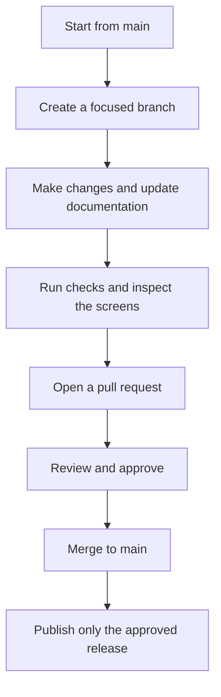

This describes the normal change process. Documentation-only updates do not activate account features or deploy a new service. Real-account releases retain a separate approval gate.

## Quality, limitations, and notices

- The main-branch application suites recorded **31 landing-page + 98 dashboard + 54 Worker checks** (183 total). The separate live deployment record includes **21 live HTTP checks and 49 live-browser checks**. These are scoped checks, not a guarantee of universal device support or a full security audit.
- This documentation refresh captured all six live tabs at desktop and mobile widths, plus the expanded mobile menu. See [capture evidence](docs/screenshots/manifest.json) for the actual URLs, times, dimensions, and file hashes.
- Supporting keyboard and responsive behaviors have been tested, but independent accessibility certification has not been performed.
- No organization has issued credentials through this service. Branding rights and domain ownership have not been independently verified.
- Applicable ISO MCP project guidance was consulted. Alignment is self-declared; no independent ISO audit or certification is claimed, and no restricted standard text is reproduced.

For screen explanations or a control that appears inactive, start with the [user manual](manual.md). For engineering work, start with the [documentation index](docs/README.md).
