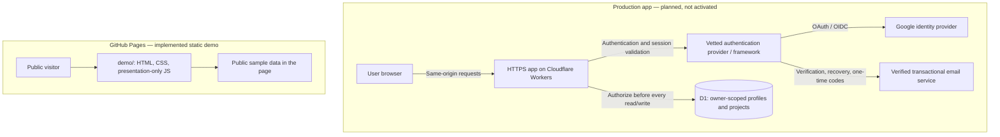
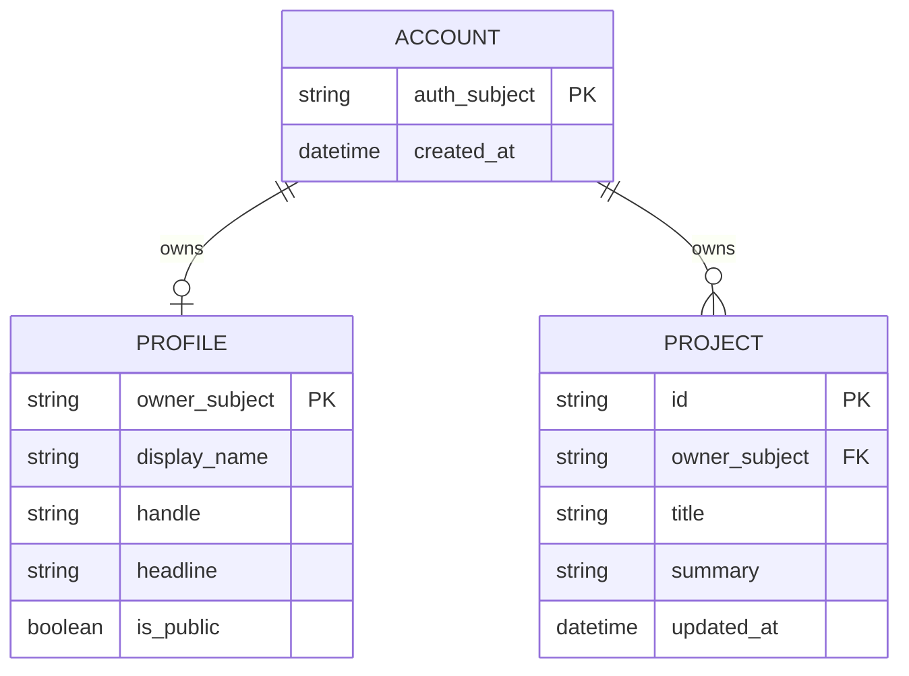

# Architecture and environment boundaries

## Implementation status

| Area                                      | State                                                                                                            |
| ----------------------------------------- | ---------------------------------------------------------------------------------------------------------------- |
| Original landing-page prototype           | Existing, unchanged                                                                                              |
| Read-only dashboard and sign-in showcase  | Implemented in `demo/`                                                                                           |
| Demo Pages packaging and workflow         | Implemented; publication requires merge, successful checks, and Pages enabled                                    |
| Production authentication and persistence | **Not implemented or deployed**; the new Cloudflare account and authentication/email services are not configured |

The production diagram below is an **approved feature direction and proposed architecture**, not evidence of deployed services. Provider choice, infrastructure identifiers, domains, and credentials remain setup gates.

## System diagram

There is deliberately **no connection** from the demo to production authentication, email, APIs, storage, or data. The demo’s CSP blocks connections and form submissions. Disabled UI controls explain the limitation; production security must never depend on those controls.

## Repository responsibilities

| Path                                 | Responsibility                                                                  |
| ------------------------------------ | ------------------------------------------------------------------------------- |
| `index.html`, `styles.css`, `app.js` | Existing landing-page prototype; not a real account system                      |
| `demo/`                              | Independently hosted, read-only dashboard and sign-in preview                   |
| `scripts/build-demo.cjs`             | Explicit allowlist of files permitted in the Pages artifact                     |
| `.github/workflows/demo-pages.yml`   | Verify changes; publish only the demo from `main`                               |
| `tests/smoke.cjs`                    | Existing landing-page regression checks                                         |
| `tests/demo.cjs`                     | Demo safety, navigation, layout, and packaging checks                           |
| `docs/`                              | Architecture, authentication requirements, release process, and actual evidence |

Do not publish the entire repository through Pages. The build output contains a root redirect, `.nojekyll`, and only the allowlisted demo assets under `/demo/`. This works under a repository URL without relying on domain-root asset paths.

## Proposed production data ownership

An authentication provider’s immutable subject identifies the account. Email addresses are not authorization keys, and matching email alone must not automatically link identities.

This is a proposed model, **not an applied migration**. Credentials and issuers are outside this first account/dashboard scope. A signed-in user must not be able to mark their own identity or projects as externally verified.

Production requirements:

- Private-by-default profiles; explicit owner consent before publication.
- Session-derived owner identifiers; never trust an owner ID supplied in a request body.
- Server-side authorization on each object, including exports and deletes.
- Parameterized SQL, schema validation, bounded payloads, and safe text rendering.
- Separate development, staging, and production bindings; never seed production with demo data.
- No authentication secrets or long-lived credentials in browser storage or the repository.

## Standards disclaimer

This design follows the applicable ISO MCP project guidance, including IAM-002, IAM-006, IAM-007, ARC-009, and REPO-026. These are implementation requirements, not a claim of certification, completed security testing, or a deployed production service.
