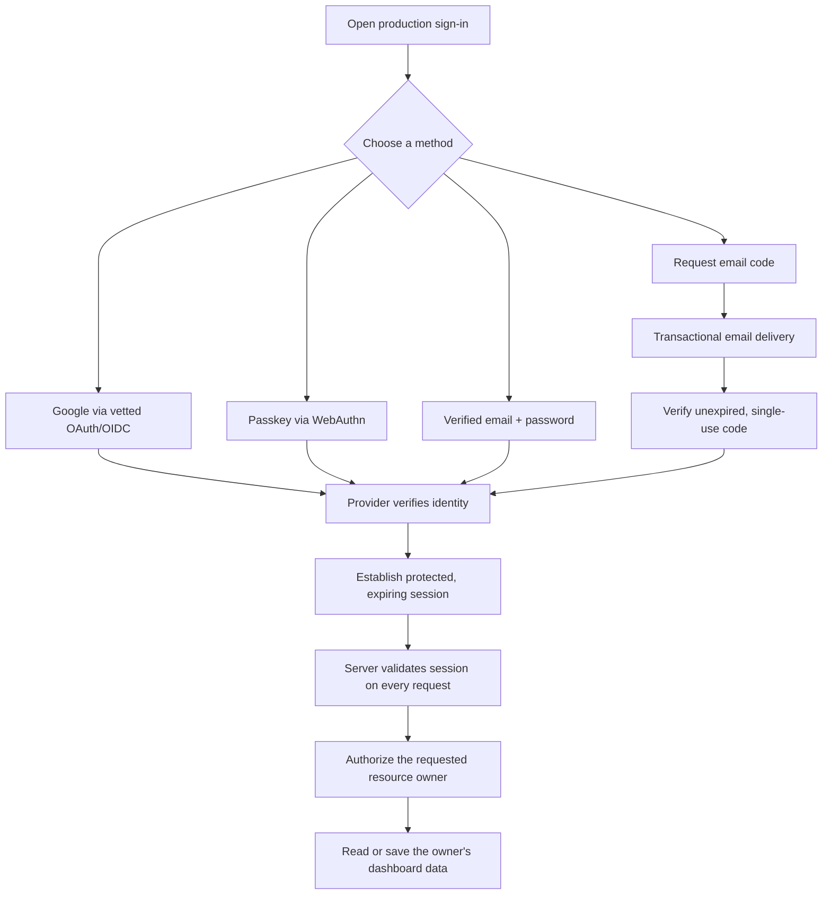
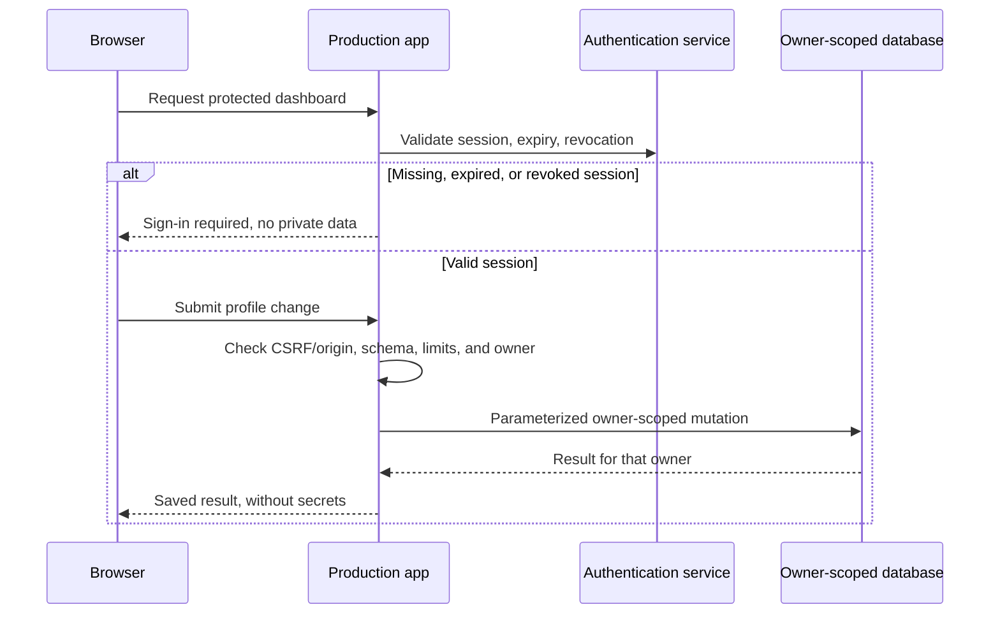

# Production authentication requirements

**Status: requirements and activation gates only. Real authentication is not implemented or enabled in this change.** Do not present the read-only sign-in preview as a usable login.

## Required methods

| Method             | Production requirement                                                                                                   | Demo behavior                                              |
| ------------------ | ------------------------------------------------------------------------------------------------------------------------ | ---------------------------------------------------------- |
| Google             | Vetted OAuth/OIDC implementation; state/nonce/PKCE where supported; exact approved redirects and minimal identity scopes | Disabled button; no redirect                               |
| Passkey            | WebAuthn through a maintained provider/framework; authenticated enrollment; stable HTTPS relying-party domain            | Disabled button; no enrollment or device prompt            |
| Email and password | Verified email, vetted password storage, recovery, abuse controls, and session invalidation                              | Disabled fields/buttons; no password value                 |
| Email code         | Real email delivery; short-lived, single-use codes bound to a transaction; attempt and resend limits                     | Disabled fields/buttons; no stored or accepted sample code |

The four methods are alternative ways to authenticate an account, not a requirement to perform all four for each sign-in. Privileged operations require additional recent-authentication/MFA policies appropriate to the selected provider. Account recovery must not silently become a weaker bypass.

The display email `demo@verifiedprofile.com` is a user-confirmed **fictional sample address** for the UI. It does not establish ownership of that address or domain. No demonstration password or fixed code is a production credential.

## Authentication journey

Any failed validation terminates without creating a session. Public error messages must avoid revealing whether an email account exists.

## Session and API controls

- Use the provider/framework’s supported session mechanism, not custom crypto or a homegrown cookie format.
- Require secure, HttpOnly, SameSite cookies for application session credentials where the selected architecture supports server sessions; document any provider-specific model before acceptance.
- Enforce idle/absolute expiry and logout invalidation. Credential recovery and sensitive account changes must revoke or rotate affected sessions.
- Require CSRF protection for cookie-authenticated mutations; check origin and allowed methods. CORS is not authorization.
- Never put private user data into public/shared caches. Protect HTML routes and APIs independently.
- Redact passwords, codes, tokens, cookies, email addresses, and passkey attestation material from routine logs.
- Rate-limit login, recovery, code verification, and resend endpoints. Use a consistent security-state store; do not rely solely on eventually consistent caches for revocation or one-use codes.
- Do not create a universal test code, a production demo user, a hidden bypass, or sample credentials accepted by the production service.

## Enrollment and recovery

- Enroll passkeys only after verifying the current account and requiring recent authentication. Define multiple-device and lost-device recovery paths.
- Select the production HTTPS domain before configuring WebAuthn relying-party IDs and OAuth callbacks. Treat domain changes as an authentication migration.
- Use a maintained password implementation with an appropriate memory-hard password hash. Password handling should be delegated to the selected provider/framework.
- Use provider-managed password reset and verification tokens with expiry, single use, generic public responses, and anti-abuse controls.
- OTP policy must specify expiry, maximum attempts, per-account/IP limits, resend cooldown, and invalidation after use. Confirm support in the provider’s documentation before selecting concrete values.
- Link another identity only after a secure, explicit account-linking flow. Email coincidence is not sufficient.

## Activation gates

1. Connect and identify the user’s **new Cloudflare account**. Do not reuse a business or older projects account without approval.
2. Select a vetted provider/framework that demonstrably supports all four methods and agrees with the session/security model.
3. Approve the production domain, application origin, OAuth callbacks, recovery links, and staging origin.
4. Configure Google OAuth consent and credentials through the provider’s secure setup.
5. Verify a transactional email sender and delivery configuration for verification, codes, and recovery.
6. Provision separate database bindings and secret stores; never commit real identifiers or secrets as examples.
7. Implement the backend, owner-scoped persistence, and protected production UI.
8. Run end-to-end positive and negative authentication/authorization tests in staging, plus a security review.
9. Run real passkey registration/sign-in/recovery on supported user devices. The remote agent browser cannot use a user’s native passkey dialog as a substitute.
10. Approve and deploy production; verify monitoring, backup/restore, rotation, and rollback procedures.

Until those gates are complete, production must fail closed. A polished demo is not proof that real authentication works.

## Acceptance tests required before production

- All four real sign-in methods; valid/invalid/replayed/expired codes.
- OAuth state/nonce/callback failures and explicit identity-linking consent.
- Passkey enrollment, wrong origin/RP, device cancellation, recovery, and revocation.
- Password verification/recovery, throttling, enumeration resistance, and session invalidation.
- User A cannot read, edit, export, or delete User B’s resources by changing IDs.
- Missing/expired/revoked sessions and invalid CSRF/origin are rejected.
- Production never accepts sample credentials or codes; the demo makes no auth/API requests.
- No secrets or personal data in browser storage, logs, build artifacts, or shared caches.

## Standards disclaimer

Applicable ISO MCP guidance includes IAM-001 through IAM-007, CODE-007, CODE-014, OPS-002, and REPO-026. This document describes required controls; it does not claim they are already implemented or certified.
