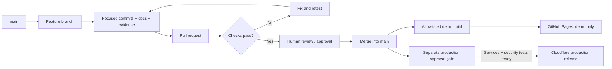

# GitHub Flow and release runbook

## Reviewable changes



The Cloudflare **production** path is a planned gate, not an implemented deployment workflow. A separate static showcase was deployed manually through the authorized Cloudflare API; see [Cloudflare runbook](CLOUDFLARE.md). For visitor guidance, see the [user manual](../manual.md). It does not activate real accounts. Never share a production secret with a Pages job.

## Implemented demo workflow

`.github/workflows/demo-pages.yml`:

1. Runs on relevant pull requests, matching `main` changes, or a manual dispatch.
2. Installs locked development dependencies and Playwright Chromium.
3. Runs the original landing-page regression checks and the read-only demo checks.
4. Builds `.site/` using an explicit allowlist.
5. On `main` only, uploads and deploys that artifact using GitHub’s official Pages actions.

Third-party actions are pinned to exact upstream commit SHAs resolved during setup. Dependency updates must review and refresh those pins. Pull-request verification receives only read access and does not deploy.

## One-time GitHub Pages setup

After reviewing and merging the feature:

1. Open [repository Pages settings](https://github.com/DevJel/verified-profile/settings/pages).
2. Under **Build and deployment → Source**, select **GitHub Actions**.
3. Configure the `github-pages` environment with the repository’s desired deployment protection policy.
4. Run **Verify and publish the read-only demo** from the Actions tab, or trigger a matching `main` change.
5. Confirm the verification and deployment jobs succeed; use GitHub’s reported deployment URL.
6. Confirm the root redirects to `/demo/`, the six screens render, all write controls are disabled, and no authentication/email/API traffic is made.

First-time Pages enablement cannot be performed by the standard workflow token. Do not add an elevated personal token merely to avoid this one-time settings step.

**Do not use “Deploy from a branch → main → root” for the new deployment.** That would publish the entire repository rather than the demo-only artifact.

## Local verification

```sh
npm ci
npx playwright install chromium
npm test
npm run build:demo
python3 -m http.server 8080 --directory .site
```

Open `http://localhost:8080/demo/`. An existing Chromium can be selected with `CHROMIUM_PATH=/path/to/chromium npm test`. Tests produce full PNG screenshots locally; checked-in derived evidence documents crop bounds and lossless conversion.

## Production release gate — not yet available

Before a Cloudflare release, connect the new account and complete the authentication activation gates. A future workflow must:

- Use a narrowly scoped deploy token stored only in the protected production environment.
- Deploy staging before production, with separate origins, bindings, and data.
- Apply reviewed migrations with backup/restore and compatibility checks.
- Pass real authentication, owner-isolation, session, and CSRF tests.
- Require human approval for the production environment.
- Record the exact commit, migration, configuration version, and smoke-test results.
- Never deploy `.site/` as a real backend, and never expose backend secrets to a Pages build.

## Rollback

For the demo, revert the responsible change, rerun checks, and redeploy the allowlisted artifact. Disable Pages to withdraw the showcase. No database or account state is involved.

Production rollback is not yet defined because no production service or schema exists. Its runbook must cover code/config rollback, migration compatibility, provider availability, session revocation, incident response, and data restoration before launch.

## Standards disclaimer

This process applies the ISO MCP project guidance for controlled changes, least privilege, traceable evidence, and deployment gates. It is not a claim of independent certification or a successful deployment.
