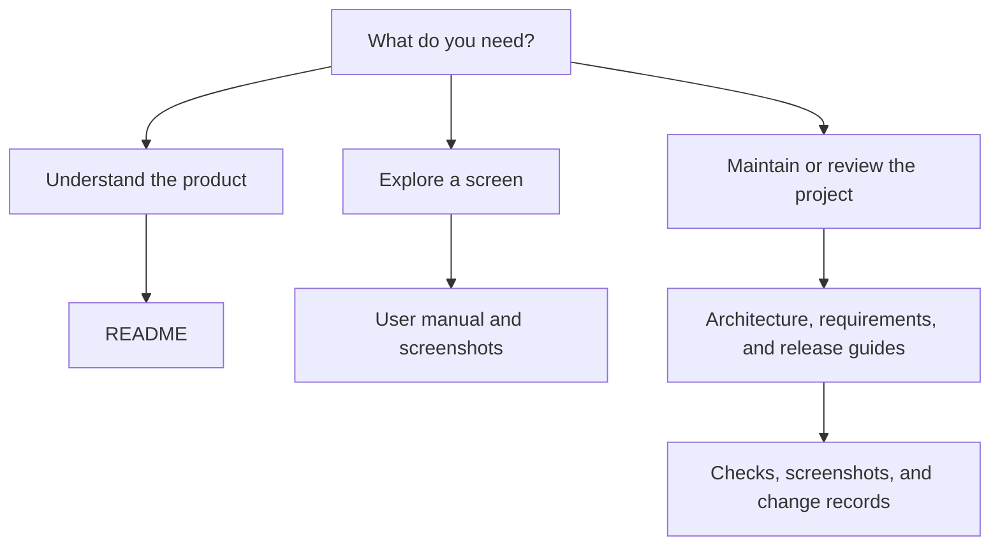

# Documentation

**[Project overview](../README.md) · [User manual](../manual.md) · [Live showcase](https://verified-profile-demo.black-tooth-5474.workers.dev/demo/)**

Start with the guide that matches your task. The current live release is a **read-only showcase**, not a working account or credential-verification service.

## For visitors and stakeholders

| Document                                                       | Use it when you want to…                                                                |
| -------------------------------------------------------------- | --------------------------------------------------------------------------------------- |
| [Project README](../README.md)                                 | Understand the product, release status, features, and project layout.                   |
| [User manual](../manual.md)                                    | Explore every tab with plain-language explanations and live desktop/mobile screenshots. |
| [Change history](../CHANGELOG.md)                              | See what has changed and distinguish live capabilities from planned work.               |
| [Screenshot gallery and capture record](screenshots/README.md) | Review the actual deployed screens and their capture details.                           |

## For maintainers and reviewers

| Document                                          | Scope                                                                                                                                                                       |
| ------------------------------------------------- | --------------------------------------------------------------------------------------------------------------------------------------------------------------------------- |
| [Demo guide](DEMO.md)                             | What the static showcase does and deliberately cannot do.                                                                                                                   |
| [Architecture](ARCHITECTURE.md)                   | Current implementation and proposed future account architecture. Future design is not an implementation claim.                                                              |
| [Authentication requirements](AUTHENTICATION.md)  | Requirements and tests needed before enabling Google, passkeys, passwords, and email codes.                                                                                 |
| [GitHub Flow and release runbook](GITHUB_FLOW.md) | Review flow, Pages publishing, release gates, and rollback.                                                                                                                 |
| [Cloudflare runbook](CLOUDFLARE.md)               | Live static Worker deployment, build/redeployment instructions, verification, and rollback. Packaging merged in [PR #2](https://github.com/DevJel/verified-profile/pull/2). |
| [Original prototype evidence](evidence/)          | Earlier landing-page tests and images, not current Cloudflare-dashboard screenshots.                                                                                        |
| [Dashboard evidence](demo-evidence/)              | Earlier responsive and behavior checks for the six-screen dashboard.                                                                                                        |
| [Implementation records](changes/)                | Dated records explaining scope, verification, and known limits for individual changes.                                                                                      |
| [Third-party notices](../THIRD_PARTY_NOTICES.md)  | Attribution and notice information for included third-party material.                                                                                                       |

## Where information belongs

- **README:** orientation and a truthful feature/status summary.
- **manual.md:** explanations for people using or evaluating the screens.
- **Engineering guides:** implementation, account protection, and deployment requirements.
- **Evidence:** actual results and screenshots, labeled by source and date.
- **Change records:** what changed and how it was checked.

## Keeping the documentation accurate

When a screen, feature, or release status changes, update the README summary and the corresponding manual section in the same change. Recapture affected screenshots from the actual release, record their source URL and date, and review them before publication. Do not relabel a planned feature as available just because its button is visible.

Never include secrets, reusable test credentials, private account data, or invented verification claims in examples. Standards alignment is self-declared; this documentation does not claim independent ISO certification or reproduce restricted standard text.
