# Verified Profile — User Manual

**A practical guide to the live dashboard showcase**

**[Open the live showcase](https://verified-profile-demo.black-tooth-5474.workers.dev/demo/) · [Project overview](README.md) · [Documentation index](docs/README.md)**

Last reviewed: **29 October 2026, Malaysia time**. Screenshots show the publicly deployed Cloudflare showcase captured on 28 October UTC / 29 October Malaysia time.

> **Please read first:** this release is a demonstration of the screens, not a working account service. You can move between tabs and read sample information. You cannot sign in, save changes, send codes, publish a profile, or manage a real account. No demo password or one-time code is required.

## Contents

1. [Who this guide is for](#who-this-guide-is-for)
2. [Getting started](#getting-started)
3. [Understanding labels and status messages](#understanding-labels-and-status-messages)
4. [Screen-by-screen guide](#screen-by-screen-guide)
   - [Overview](#1-overview)
   - [My profile](#2-my-profile)
   - [Projects](#3-projects)
   - [Credentials](#4-credentials)
   - [Account & security](#5-account--security)
   - [Sign-in preview](#6-sign-in-preview)
5. [Using the dashboard on a phone or tablet](#using-the-dashboard-on-a-phone-or-tablet)
6. [Keyboard navigation](#keyboard-navigation)
7. [Privacy and safety](#privacy-and-safety)
8. [Common questions and troubleshooting](#common-questions-and-troubleshooting)
9. [The separate landing-page prototype](#the-separate-landing-page-prototype)
10. [What a future account release needs](#what-a-future-account-release-needs)
11. [Glossary](#glossary)
12. [Further reading and documentation notes](#further-reading-and-documentation-notes)

## Who this guide is for

This manual is for visitors, potential users, business stakeholders, and reviewers who want to understand the product without reading its code. It explains what each part of the dashboard means, what works today, and which controls are illustrations of future capabilities.

Verified Profile's direction is to bring a person's professional information, projects, and credentials into one place. The current showcase demonstrates how that information could be presented. It does not connect to employers, credential issuers, repositories, or an account database.

## Getting started

### On a desktop or larger screen

1. Open the [live dashboard](https://verified-profile-demo.black-tooth-5474.workers.dev/demo/).
2. Read the blue notice near the top. It explains that all records are samples.
3. Use the menu on the left to choose **Overview**, **My profile**, **Projects**, **Credentials**, **Account & security**, or **Sign-in preview**.
4. Read the selected screen. The selected menu item is highlighted.
5. Choose another screen whenever you want to continue exploring.

### On a phone

1. Open the same live link in your browser.
2. Select **Menu** in the top-right corner.
3. Choose a screen. The menu closes and the chosen screen appears.
4. Scroll down to see the remaining cards and explanations.

You do not need to create an account, provide an email address, install an application, or complete a login to browse this showcase.

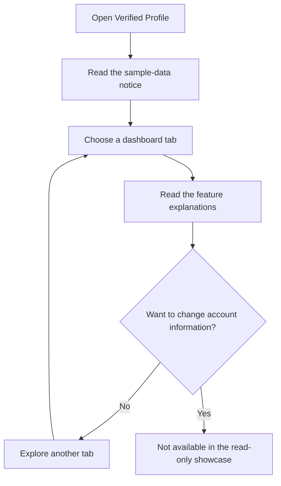

## Understanding labels and status messages

| Label or message                               | What it means in everyday language                                                                                                        |
| ---------------------------------------------- | ----------------------------------------------------------------------------------------------------------------------------------------- |
| **Read-only demo / Showcase**                  | You are viewing example screens. The page cannot change an account.                                                                       |
| **Sample / Sample record / Fictional example** | The information illustrates a feature. It is not an imported or verified personal record.                                                 |
| **Not verified**                               | There has been no confirmation of the claim, identity, or work shown.                                                                     |
| **Not issued / No issued credentials**         | No organization has issued a credential to this sample profile.                                                                           |
| **Issuer not connected**                       | There is no organization connected to confirm or issue a credential.                                                                      |
| **Public profile Off**                         | The demonstration does not publish this sample profile as a real account's public page. The showcase itself is still publicly accessible. |
| **Planned / UI preview only**                  | The page shows how a future feature might look; the supporting service is not ready.                                                      |
| **No active session / You are not signed in**  | You are a visitor to a public showcase, not the owner of a signed-in account.                                                             |

Buttons may still look prominent, even though they are disabled. Read the surrounding labels rather than treating a blue button as evidence that its action is available.

## Screen-by-screen guide

The images below show the **actual live showcase**. Desktop screenshots were captured at a 1440px browser width; mobile screenshots at 390px. Some complete captures appear as two consecutive image parts to fit repository-upload limits. The parts continue in order with no content omitted or resized. Longer screenshots require scrolling or opening the images at full size.

### 1. Overview

**Purpose:** understand the workspace at a glance and choose where to go next.

**[Open Overview](https://verified-profile-demo.black-tooth-5474.workers.dev/demo/#overview)**

#### What each part means

| Screen feature                  | Explanation                                                                          | Availability now                            |
| ------------------------------- | ------------------------------------------------------------------------------------ | ------------------------------------------- |
| Sample-data notice              | A reminder that you are not signed in and the displayed information is illustrative. | Visible on every dashboard screen.          |
| Sample projects: **02**         | Two project examples are included to demonstrate the layout.                         | View only; these are not your projects.     |
| Issued credentials: **00**      | The showcase has no issued credentials. Zero is intentional, not an error.           | View only; no verification has taken place. |
| Planned sign-in options: **04** | Four future sign-in methods are illustrated.                                         | None is active.                             |
| Your profile                    | A sample name, handle, email, short description, visibility, and issuer status.      | View only.                                  |
| Project preview                 | A short introduction to the two fictional projects.                                  | View only.                                  |
| Explore profile screen          | Takes you to **My profile**.                                                         | Working navigation.                         |
| Explore project screen          | Takes you to **Projects**.                                                           | Working navigation.                         |
| Explore sign-in screens         | Takes you to **Sign-in preview**.                                                    | Working navigation.                         |
| Edit workspace                  | Illustrates where a future editing action might be offered.                          | Disabled; does not open an editor.          |

**Suggested next step:** choose **Explore profile screen** to see how a professional introduction could be organized.

View the mobile Overview screenshot

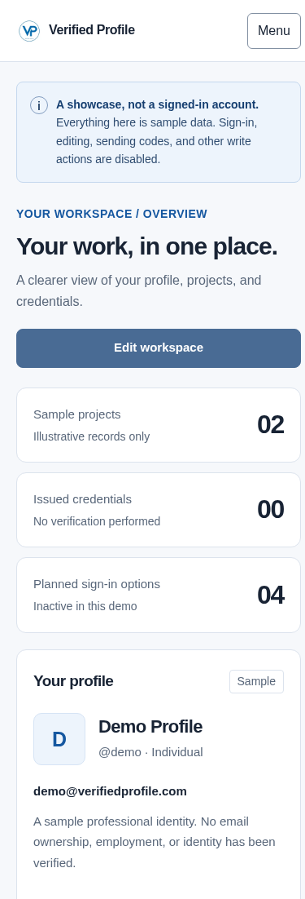
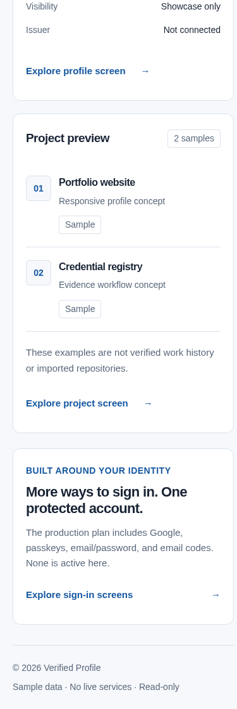

### 2. My profile

**Purpose:** show the information that could describe a person or organization, with clear visibility and credential context.

**[Open My profile](https://verified-profile-demo.black-tooth-5474.workers.dev/demo/#profile)**

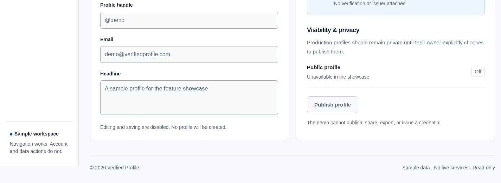

#### Profile details

| Field          | What it means                                                                                              |
| -------------- | ---------------------------------------------------------------------------------------------------------- |
| Display name   | The name a visitor would see, illustrated here as **Demo Profile**.                                        |
| Profile handle | A short label for the profile, illustrated as **@demo**. It is not a reserved handle.                      |
| Email          | An illustrative address, **demo@verifiedprofile.com**. It does not give you access to an inbox or account. |
| Headline       | A short introduction that could help someone understand the profile.                                       |

All fields are disabled. **Save profile** does not save or create a record.

#### Profile badge

The badge-style panel brings the sample name and status together visually. **Sample profile** and **Not issued** mean it is not an awarded credential. The logo is branding, not proof that a person has passed an identity check.

#### Visibility & privacy

- **Public profile: Off** illustrates a private-by-default account setting.
- The showcase cannot change the setting or publish a public profile.
- **Publish profile** is disabled. No share link, exported record, or credential is produced.
- A future real-account release should let an owner decide what to publish; that choice is not connected here.

**Suggested next step:** visit **Projects** to understand how work could support the profile's story.

View the mobile My profile screenshot

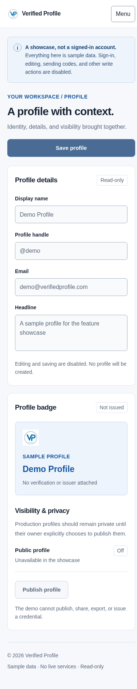

### 3. Projects

**Purpose:** explain the work behind a profile, without confusing a project description with a verified work record.

**[Open Projects](https://verified-profile-demo.black-tooth-5474.workers.dev/demo/#projects)**

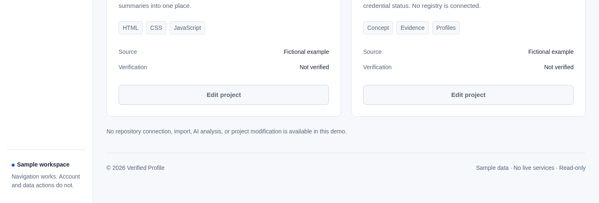

#### Included examples

| Project                 | What the example illustrates                                                                                                                                                           |
| ----------------------- | -------------------------------------------------------------------------------------------------------------------------------------------------------------------------------------- |
| **Portfolio website**   | A place to present a professional introduction and project summaries. Labels such as HTML, CSS, and JavaScript describe the example's subject. They are not awarded skill credentials. |
| **Credential registry** | A proposed way to organize issuer details, evidence, and credential status. No external registry is connected.                                                                         |

#### Reading a project card

- **Title and description:** a short explanation of the example.
- **Tags:** quick topic labels to make the card easier to scan.
- **Source: Fictional example:** the project is sample content, not a retrieved repository.
- **Verification: Not verified:** no review has established ownership, employment, or delivery of this work.
- **Sample record:** a reminder that the card is illustrative.

**Add project** and **Edit project** are disabled. The showcase cannot import a repository, upload a project, connect GitHub, analyze code, or update a record.

**Suggested next step:** open **Credentials** to see how issued evidence differs from a self-described project.

View the mobile Projects screenshot

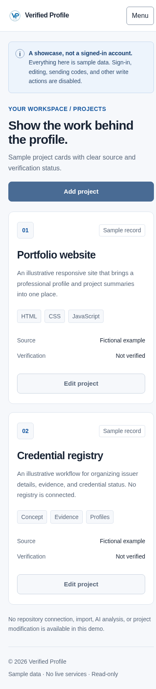

### 4. Credentials

**Purpose:** make it clear whether a credential has actually been issued and what it can establish.

**[Open Credentials](https://verified-profile-demo.black-tooth-5474.workers.dev/demo/#badges)**

The empty state says **“There's no verification to claim.”** This is deliberate. The sample account has no issued badges, validated identity, or verified employment. The page does not pretend a successful verification happened.

| Screen feature        | What it means                                                      | Availability now                        |
| --------------------- | ------------------------------------------------------------------ | --------------------------------------- |
| No issued credentials | There are no records to display as awards or issued confirmations. | Honest empty state.                     |
| Request credential    | A possible future way to ask an organization for a credential.     | Disabled; no request is sent.           |
| Connect an issuer     | A possible future connection to the organization making a claim.   | Disabled; no organization is connected. |

A future credential should identify the issuing organization and explain what it confirms. **Signing in to an account is not the same as having professional credentials verified.**

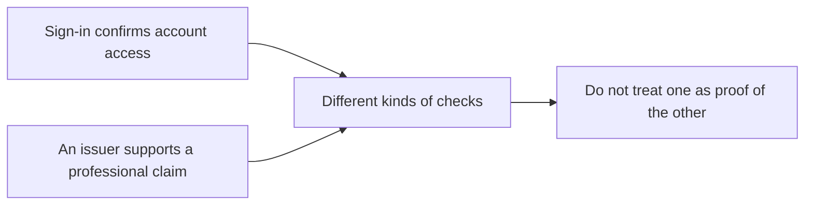

**Suggested next step:** visit **Account & security** to understand account protection separately from credential issuance.

View the mobile Credentials screenshot

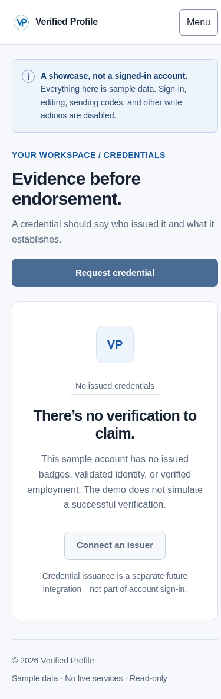

### 5. Account & security

**Purpose:** show the account-protection and data-control options planned for a real signed-in workspace.

**[Open Account & security](https://verified-profile-demo.black-tooth-5474.workers.dev/demo/#account)**

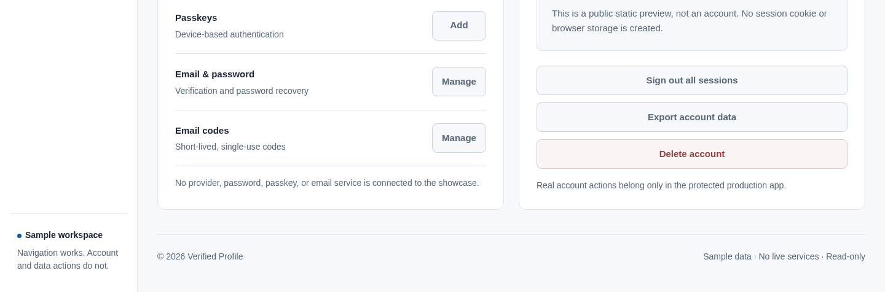

#### Sign-in methods

| Option                        | Plain-language explanation                                                                                 | What the current control does                              |
| ----------------------------- | ---------------------------------------------------------------------------------------------------------- | ---------------------------------------------------------- |
| Google — **Connect**          | A future way to use your Google account to access Verified Profile.                                        | Nothing; no Google account is connected.                   |
| Passkeys — **Add**            | A future device-supported sign-in credential, often unlocked with a fingerprint, face scan, or device PIN. | Nothing; no passkey is created and no device prompt opens. |
| Email & password — **Manage** | A future place to manage a password-based sign-in method.                                                  | Nothing; no password is accepted or changed.               |
| Email codes — **Manage**      | A future place to manage a short-lived code sent to your email.                                            | Nothing; no email service is connected.                    |

#### Sessions & account data

A **session** means a period in which the service recognizes you as signed in. Here, **No active session** and **You are not signed in** mean exactly that: browsing does not create a real account session.

| Control               | What a future version could do                              | Current behavior                                     |
| --------------------- | ----------------------------------------------------------- | ---------------------------------------------------- |
| Sign out all sessions | End access on other signed-in devices.                      | Disabled; there are no signed-in sessions to manage. |
| Export account data   | Provide a copy of the account owner's stored information.   | Disabled; no export file is created.                 |
| Delete account        | Remove an account through a protected confirmation process. | Disabled; no account or information is deleted.      |

**Suggested next step:** open **Sign-in preview** to compare the four proposed access methods.

View the mobile Account & security screenshot

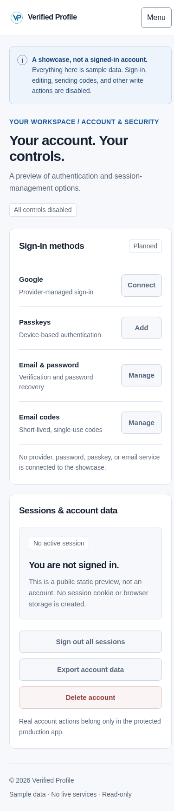

### 6. Sign-in preview

**Purpose:** explain the four requested sign-in choices without implying that login is already working.

**[Open Sign-in preview](https://verified-profile-demo.black-tooth-5474.workers.dev/demo/#signin)**

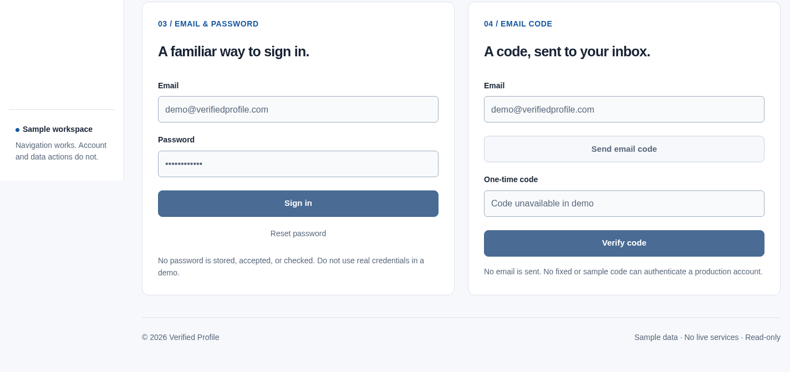

#### Continue with Google

In a future account release, this would use a Google identity through an approved sign-in service. In this showcase, **Continue with Google** is disabled. It does not open Google, request permission, link an identity, or sign you in.

#### Sign in with a passkey

A future passkey would use a supported device and would require secure setup for the account. **Use a passkey** is disabled here. It does not open a fingerprint, face, PIN, or device-registration prompt. Seeing this card does not mean a passkey has been enrolled.

#### Email & password

The email field displays the sample address. The password field's dots are a visual placeholder, **not a saved password**. **Sign in** and **Reset password** are disabled. No password is stored, checked, or recovered.

Do not try a real password or assume that sample credentials provide access. This showcase has no valid password-based login.

#### Email code

The proposed flow is to request a short-lived code and enter it after receiving it by email. The showcase's **Send email code** and **Verify code** controls are disabled. No email is sent; the code field is unavailable. A fixed or sample code cannot authenticate anyone.

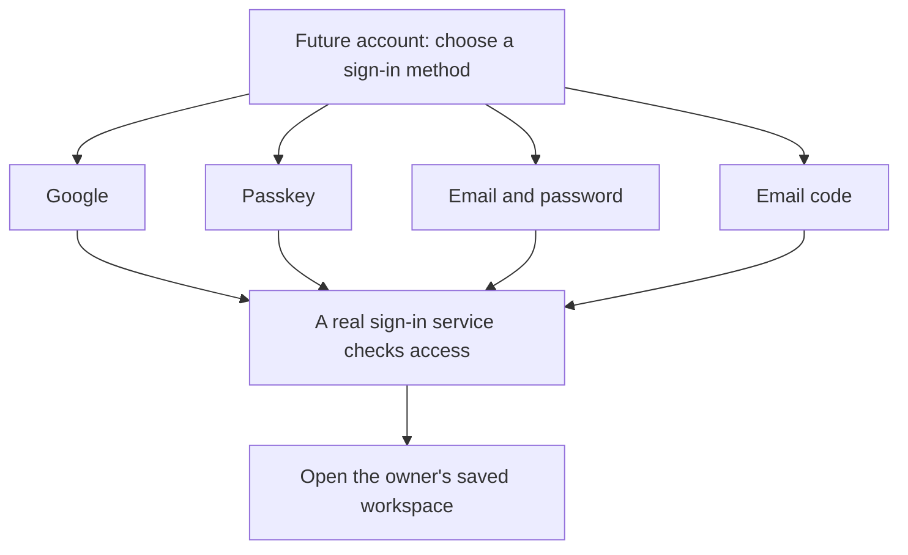

_Future account illustration only. None of these sign-in paths is active in the showcase. The four methods are alternatives, not four steps that everyone must complete._

View the mobile Sign-in preview screenshot

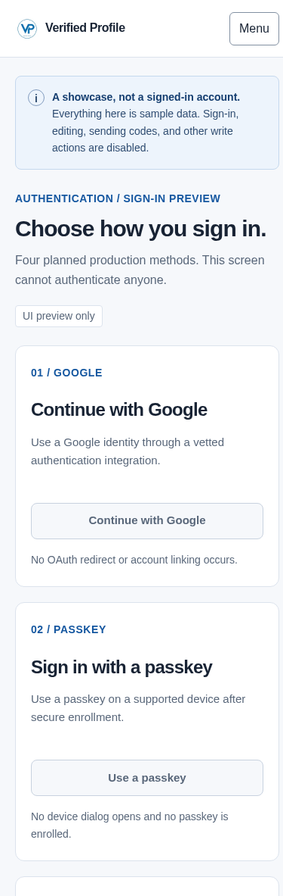
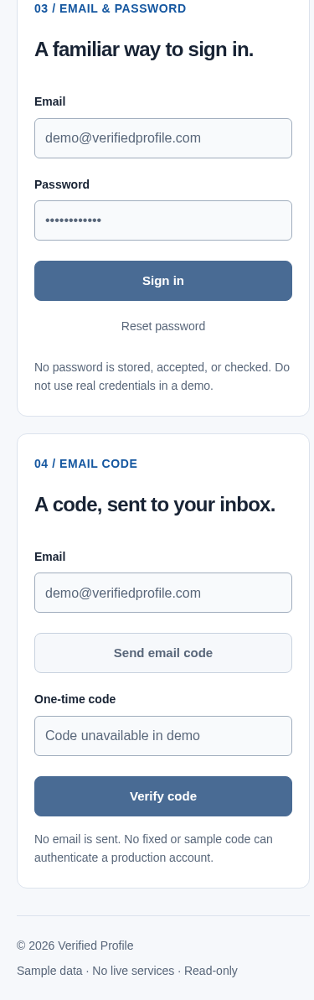

## Using the dashboard on a phone or tablet

The page reorganizes itself to fit the browser width. On smaller screens, cards stack vertically and a **Menu** button replaces the left-hand navigation. On larger tablets, the layout may resemble the desktop version; this depends on the available screen width rather than the device's brand.

### Opening and closing the menu

1. Select **Menu** to show the screen list.
2. Select a tab to open it. The menu closes automatically.
3. Select **Menu** again to close it without changing screens.
4. With a keyboard, Escape also closes the expanded menu and returns focus to the Menu button.

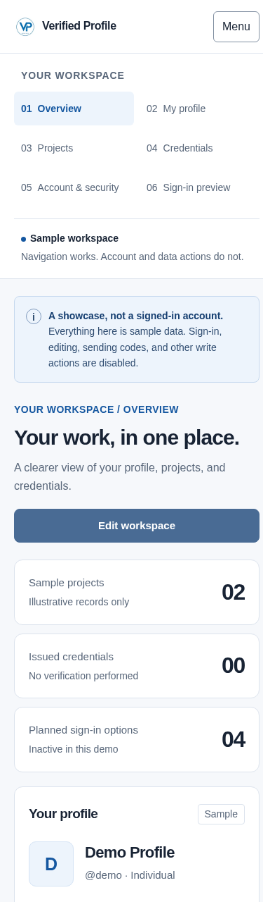
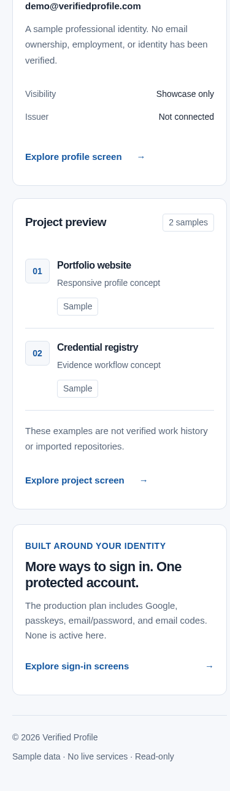

The menu is part of the page; it is not a login panel. The avatar and sample-workspace indicators are decorative or explanatory and do not mean you are signed in.

If a screenshot looks very tall, that is because it captures the **entire page**, including information below the first screen. On your phone, scroll normally to read it.

## Keyboard navigation

- Use **Tab** to move between available links and the menu button.
- Use **Enter** to follow a focused link or activate the Menu button; a focused button also supports Space.
- Use the **Skip to content** link to move past repeated navigation.
- A visible outline identifies the focused element. After a screen change, focus can move to its heading so keyboard users know where they are.
- Disabled fields and account controls are not active tasks and may be skipped by the keyboard.
- The page supports reduced-motion preferences. Understanding the content does not require an animation.

These are implemented accessibility features, not a claim of independent accessibility certification or compatibility with every assistive technology.

## Privacy and safety

### What viewing the showcase does

Your browser downloads the public page, styling, navigation code, and logo from Cloudflare. You can view the sample content and switch screens. The dashboard does not create a signed-in account, save an entry, or send an account-change request.

### What it does not do

- No Google connection, passkey setup, password check, or code verification.
- No verification email, invitation, credential request, or issuer connection.
- No saved personal profile, project import, public-profile publication, or data export.
- No application analytics, account-session cookie, or browser-storage record added by the dashboard.

Cloudflare may maintain its own hosting or security request logs. The public showcase is not a place for confidential information. A sample email address or branded badge does not establish ownership of a domain, identity, qualification, or employer relationship.

### Sharing a screen

You may share the public showcase link or a tab link to explain the product. Do not describe the shared page as someone's verified account. The demo cannot publish, export, or issue a real credential.

## Common questions and troubleshooting

| Question or symptom                                                      | Explanation and next step                                                                                                                                                                                                                                                 |
| ------------------------------------------------------------------------ | ------------------------------------------------------------------------------------------------------------------------------------------------------------------------------------------------------------------------------------------------------------------------- |
| **The Save, Edit, Publish, Connect, or Sign-in button does nothing.**    | This is expected. These controls are disabled in the read-only release. Use navigation links to explore instead.                                                                                                                                                          |
| **What demo password or code should I use?**                             | None. The showcase cannot authenticate anyone. There is no working demo account.                                                                                                                                                                                          |
| **I did not receive an email code or password-reset message.**           | No email is sent by the showcase. There is no active email-code or recovery flow.                                                                                                                                                                                         |
| **Google or the passkey prompt does not open.**                          | Those integrations are not connected. This is not an instruction to change your device's security settings.                                                                                                                                                               |
| **Credentials shows zero. Is the page broken?**                          | No. The page intentionally shows that no credentials have been issued.                                                                                                                                                                                                    |
| **Where are my real projects or details?**                               | The showcase does not load personal accounts or repositories. All included records are samples.                                                                                                                                                                           |
| **I cannot find the tabs on my phone.**                                  | Select Menu at the top-right, then choose a tab.                                                                                                                                                                                                                          |
| **A direct link opened Overview instead.**                               | An unrecognized tab falls back to Overview. Use one of the links in this manual. The Credentials tab uses `#badges`.                                                                                                                                                      |
| **I see only the Overview and a JavaScript-disabled notice.**            | The initial page remains readable without JavaScript, but changing screens requires the page's navigation script. If your browser or organization blocks scripts, follow its policy or ask your administrator; do not disable security protections just to view the demo. |
| **The page does not load or its styling is missing.**                    | Check the connection and reload. If it persists, record the URL, time, browser, and device and report the issue through the repository. Do not include passwords, codes, or private account information.                                                                  |
| **A screen reader or browser behaves differently from the screenshots.** | Screenshots document specific browser widths, not every device. Report what you expected and what happened, with non-sensitive device/browser details.                                                                                                                    |

## The separate landing-page prototype

The repository also contains an earlier product-introduction page at its root: `index.html`, `styles.css`, and `app.js`. It is preserved separately from the Cloudflare dashboard shown in this manual.

That earlier prototype includes:

- A product introduction and explanations of the badge concept.
- Portfolio, badges, and xCoder AI presentation tabs.
- An in-page profile preview using information typed for the current visit.
- A QR code containing clearly labeled demo text, not a working verification link.
- A copy-details action and a privacy explanation.

Those interactions are **not features of the read-only dashboard deployment**. They do not create an account, reserve a handle, verify a person, or issue a credential. Reloading the original prototype resets its in-page entries. Do not use sensitive information there either.

See [the earlier prototype screenshots](docs/evidence/) if you are reviewing the design's development history. They should not be presented as screenshots of the live Cloudflare dashboard.

## What a future account release needs

Before Verified Profile can support real accounts, the project still needs the underlying sign-in service, an approved app address, email delivery, protected saved data, recovery controls, and testing of the complete experience.

A future release should not be called ready simply because a login screen looks finished. It must demonstrate that the correct person can access and change only their own information, that recovery works safely, and that old or incorrect credentials are rejected.

Real credential issuance is an additional, separate capability. A working account alone would not establish someone's professional qualifications.

See the [account requirements](docs/AUTHENTICATION.md) for the detailed engineering gates. This manual does not approve a provider, buy a plan, or activate a service.

## Glossary

| Term                  | Meaning                                                                                                               |
| --------------------- | --------------------------------------------------------------------------------------------------------------------- |
| Dashboard / workspace | The collection of screens used to view or manage related information. Here it is a sample workspace only.             |
| Handle                | A short profile label, such as `@demo`.                                                                               |
| Credential            | A record issued by an organization that makes a specific claim about someone or something.                            |
| Issuer                | The organization responsible for issuing a credential and standing behind its claim.                                  |
| Verification          | A check of a particular claim. A label or attractive badge alone does not perform that check.                         |
| Passkey               | A sign-in credential used through a supported device, commonly unlocked with a device PIN, fingerprint, or face scan. |
| One-time code         | A short-lived sign-in code intended for one use. The showcase sends and accepts none.                                 |
| Session               | A period during which a service recognizes someone as signed in.                                                      |
| Read-only             | Available to view, without the ability to change or save account information.                                         |
| Prototype / showcase  | An example of how a product could look or behave, not a promise that every displayed service is available.            |

## Further reading and documentation notes

- [Project README](README.md): product overview, feature map, repository structure, and contributor links.
- [Documentation index](docs/README.md): the full set of product and engineering documents.
- [Demo guide](docs/DEMO.md): implementation boundaries for reviewers.
- [Screenshot record](docs/screenshots/README.md): actual capture URLs, dates, formats, and integrity records.
- [Change history](CHANGELOG.md): what changed and what is live versus still planned.

This manual follows applicable ISO MCP project guidance for accurate documentation and authentic evidence. Alignment is self-declared; no independent ISO audit, certification, or complete accessibility/security assessment is claimed. No restricted standard text is reproduced.
